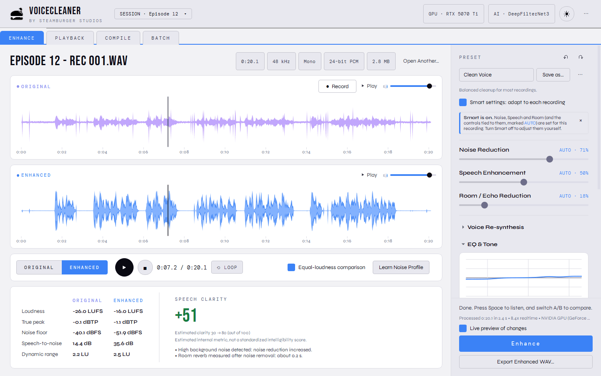
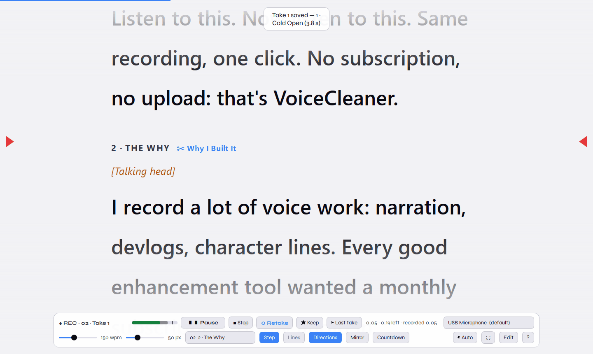
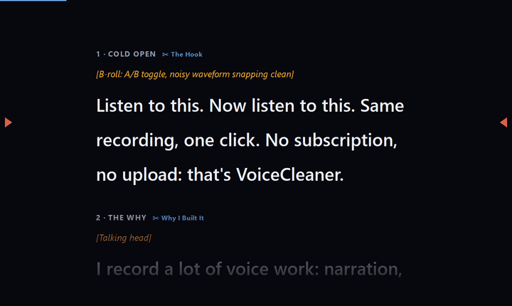
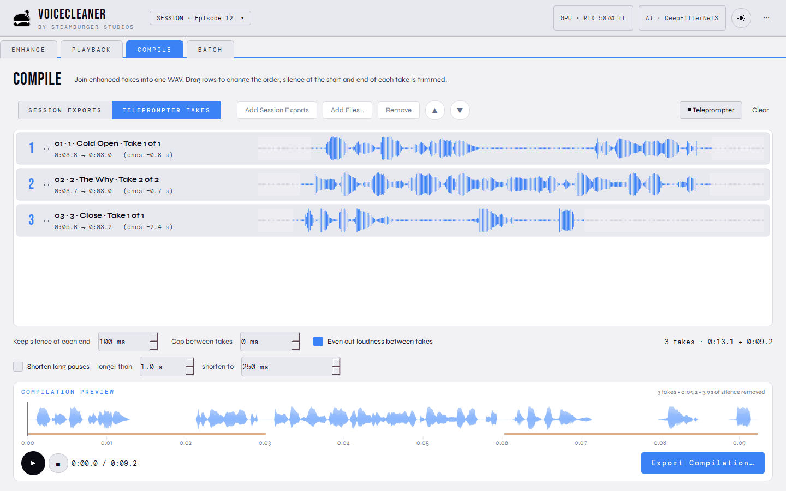
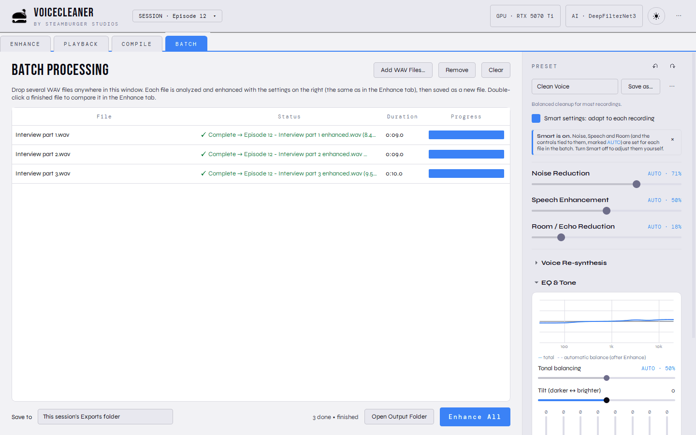
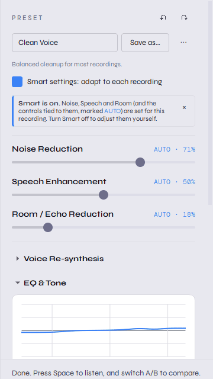
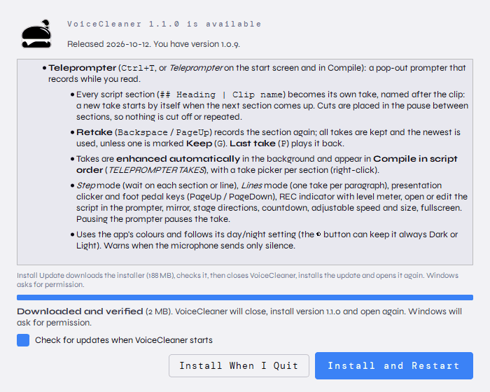

# VoiceCleaner by Steamburger Studios

<https://www.steamburgerstudios.com/>

A desktop application that turns noisy, poorly recorded speech into clean, clear,
professional-sounding audio. Drop a WAV file, listen to before/after with an instant
A/B switch, and export.

**Workflow:** Drop WAV → automatic analysis → Enhance → Listen (A/B) → Export.

It works fully offline. It runs on any CPU and uses an NVIDIA GPU automatically when one
is present.

<picture>
  <source media="(prefers-color-scheme: dark)" srcset="docs/screenshots/enhance-dark.png">
  
</picture>

## Screenshots

**Teleprompter:** read your script while it records, one take per section. Retake any
section; the takes are enhanced automatically.

<picture>
  <source media="(prefers-color-scheme: dark)" srcset="docs/screenshots/teleprompter-dark.png">
  
</picture>



**Compile:** the teleprompter's takes in script order, ready to join into one file.

<picture>
  <source media="(prefers-color-scheme: dark)" srcset="docs/screenshots/compile-dark.png">
  
</picture>

<table>
<tr>
<td width="62%">

**Batch:** enhance many files at once, with the same settings sidebar as Enhance.

<picture>
  <source media="(prefers-color-scheme: dark)" srcset="docs/screenshots/batch-dark.png">
  
</picture>

</td>
<td>

**Smart settings and presets:** analysis sets the cleanup for each recording.

<picture>
  <source media="(prefers-color-scheme: dark)" srcset="docs/screenshots/settings-dark.png">
  
</picture>

</td>
</tr>
</table>

**Updates:** VoiceCleaner downloads, checks and installs new versions itself (Windows).

<picture>
  <source media="(prefers-color-scheme: dark)" srcset="docs/screenshots/update-dark.png">
  
</picture>

Screenshots are generated with `python tools/screenshots.py` (demo content, both themes).

## Quick start (from source)

Requires Windows and **Python 3.11** (DeepFilterNet's native library ships Windows
wheels only up to 3.11).

```powershell
py -3.11 -m venv .venv
.venv\Scripts\python -m pip install torch torchaudio --index-url https://download.pytorch.org/whl/cu128   # NVIDIA GPU
#   ...or: --index-url https://download.pytorch.org/whl/cpu                                              # CPU only
.venv\Scripts\python -m pip install -r requirements-dev.txt
.venv\Scripts\python tools\download_models.py      # DeepFilterNet3, 8.7 MB, checksum-verified
.venv\Scripts\python -m app.main
```

Run the tests with `.venv\Scripts\python -m pytest`. To build the standalone app, run
`.venv\Scripts\python tools\build_windows.py`; the result is `dist\VoiceCleaner\VoiceCleaner.exe`.

### macOS

Requires macOS 12+ on Apple Silicon (an Intel Mac works too if you build there) and
**Python 3.11** (for example `uv python install 3.11`).

```bash
python3.11 -m venv .venv
.venv/bin/python -m pip install torch torchaudio
.venv/bin/python -m pip install -r requirements-dev.txt
.venv/bin/python tools/download_models.py
.venv/bin/python -m app.main
```

To build the app and its disk image, run `.venv/bin/python tools/build_mac.py`. The result
is `dist/mac/VoiceCleaner.app` plus `release/<version>/VoiceCleaner-<version>-macos-arm64.dmg`
and `.zip`. Add `--sign "Developer ID Application: …" --notarize <profile>` for a
build that opens without a Gatekeeper warning, and `--publish` to upload it to the GitHub
release. On macOS:

* noise reduction runs on the CPU (about 30x realtime on Apple Silicon, faster than on the
  Apple GPU for this small model), and voice re-synthesis runs on the Apple GPU (about 3x
  realtime instead of 0.6x on the CPU; *CPU only* in the menu turns this off);
* desktop-audio (loopback) recording is unavailable because macOS has no system loopback
  device; microphone recording works, and macOS asks for permission the first time;
* preferences and downloaded models live in `~/Library/Application Support/VoiceCleaner`,
  and logs in `~/Library/Logs/VoiceCleaner`.

## Releasing

Releases ship in two editions built from the same code:

| Edition | PyTorch | For | Packages |
|---|---|---|---|
| Standard | CPU (`.venv-cpu`) | every PC | single-file `.msi` (~0.3 GB), portable `.zip` |
| NVIDIA GPU | CUDA 12.8 (`.venv`) | NVIDIA cards, much faster | ~1 MB web installer, `.msi` + `vcgpu*.cab`, split portable zip |

Neither edition bundles the 490 MB voice re-synthesis model (BigVGAN). The app downloads
it the first time the feature is used, checksum-verified, into
`%LOCALAPPDATA%\VoiceCleaner\models`. The 9 MB noise-reduction model is bundled, so
everything else works offline. With this, every release file fits GitHub's 2 GB
per-file limit.

One-time setup:

```powershell
py -3.11 -m venv .venv-cpu
.venv-cpu\Scripts\python -m pip install torch==2.11.0 torchaudio==2.11.0 --index-url https://download.pytorch.org/whl/cpu
.venv-cpu\Scripts\python -m pip install -r requirements.txt pyinstaller pytest pyloudnorm
dotnet tool restore                      # WiX Toolset 5 (pinned in .config/dotnet-tools.json)
gh auth login                            # GitHub CLI, for publishing
```

Build, and optionally publish to GitHub as release `v<version>`:

```powershell
.venv\Scripts\python tools\release.py              # both editions -> release\<version>.venv\Scripts\python tools\release.py --publish    # ...and upload the GitHub release
.venv\Scripts\python tools\release.py --publish-only
```

How the GPU edition is delivered:
* **Web installer:** a WiX Burn bundle (`packaging/wix/Bundle.wxs`) that downloads the
  GPU `.msi` and its cabinets from the GitHub release and verifies every file against a
  hash recorded at build time. A tampered or corrupted download is rejected.
* **Portable ZIP:** split into parts under 2 GB. 7-Zip opens the `.001` part directly, or
  the parts can be joined with `copy /b` and opened in Windows.

The installers:
* install per-machine into `Program Files\Steamburger Studios\VoiceCleaner`;
* add Start Menu and Desktop shortcuts and an Add/Remove Programs entry;
* share one upgrade code, so installing either edition replaces the other.

Version numbers come from `APP_VERSION` in `app/utils/config.py`. Keep the MSI and
bundle upgrade codes unchanged between releases. Builds are not code-signed, so Windows
SmartScreen warns on first run until they are signed (`signtool sign`).

## What it does

| Problem | How VoiceCleaner handles it |
|---|---|
| Steady noise (fans, HVAC, computer, hiss, mic self-noise) | Noise profile learned from pauses (or a region you select), then a decision-directed Wiener filter, followed by the AI model |
| Changing noise (traffic, rustle, babble) | DeepFilterNet3 neural speech enhancement |
| Clicks, taps, keyboard in pauses | Transient suppressor (never touches speech) |
| Electrical hum | Automatic 50/60 Hz and harmonic detection, narrow zero-phase notches |
| Rumble | Adaptive high-pass, always below the speaker's lowest pitch |
| Room reverb, mild echo | Statistical late-reverb suppression using the measured RT60; cepstral echo detection |
| Dull, muddy, boomy voice | Adaptive EQ comparing the voice with a natural long-term speech spectrum; gentle, limited corrections |
| Leftover processing artifacts, thin or smeared voice | Optional neural voice re-synthesis (NVIDIA BigVGAN-v2): the cleaned voice is regenerated by a vocoder, blended coherently by a strength slider |
| Tone | Automatic tonal balancing toward a natural voice spectrum, plus an 8-band graphic EQ (80 Hz-10 kHz, +-12 dB) and a darker/brighter tilt, all zero-phase |
| Uneven levels | Dynamic leveling (speech-aware gain riding over seconds, frozen in pauses), gentle compressor (soft knee, linked stereo) and an optional soft expander |
| Loudness | ITU-R BS.1770-4 integrated loudness to -16 LUFS by default, true-peak limiter at -1 dBTP |

Every result goes through a **quality check**. VoiceCleaner compares the enhanced audio
with the original: lost syllables, changed voice tone, high-frequency artifacts,
over-compression, clipping. If it finds a problem, it reprocesses with gentler settings.
The guiding rule is *better speech, not obviously processed speech*.

## Using it

* **Simple controls:** a preset plus three sliders (Noise Reduction, Speech Enhancement,
  Room/Echo Reduction). Every control is remembered between sessions.
* **Smart settings** (*Smart settings: adapt to each recording*, on by default): analysis
  sets Noise, Speech and Room, and the controls tied to them, for each recording. Clean
  recordings get light processing and noisy ones get more. While Smart is on, those
  controls are locked and marked **AUTO**, and a note explains why. Turn Smart off to set
  them yourself; your values then stay as they are when you open another recording.
  Everything else (re-synthesis, leveling, EQ, ...) is always yours.
* **Presets:** *Save as…* stores all current settings as your own preset (the `⋯` menu
  next to it updates, renames or deletes it, or shows the presets folder). Presets are
  JSON files in `%APPDATA%\VoiceCleaner\presets` (macOS:
  `~/Library/Application Support/VoiceCleaner/presets`), easy to back up or share.
  **MODIFIED** appears when you change a control; *Reset* goes back to the preset.
  Double-click any slider to reset just that one.
* **Voice Re-synthesis:** set the amount (off by default). The model (490 MB) can be
  downloaded from inside the app the first time.
* **EQ & Tone:** a live response curve, *Tonal balancing* (automatic correction
  amount), *Tilt*, and eight band sliders (double-click a band to reset it).
* **Dynamics:**
  * *Leveling* (amount, maximum correction, speed) evens out sentences and speakers.
  * *Compression* (amount, threshold, ratio, attack, release) controls word-level peaks.
* **Advanced:** noise floor bias, spectral subtraction strength, noise gate, residual
  noise floor, presence, clarity, low-end cleanup, reverb/echo, target loudness and
  peak ceiling.
* **Learn Noise Profile:** drag across a background-only part of either waveform, then
  click *Learn Noise Profile*.
* **A/B:** press `A` / `B` (or the buttons) during playback; the switch is instant and
  click-free at the same position. *Equal-loudness comparison* plays the original at
  the enhanced loudness so you judge quality, not volume.
* **Loop** (`L`): drag across either waveform and turn on *Loop* to repeat just that
  passage while you switch A/B or change settings. Without a selection the whole
  recording loops.
* **Live preview of changes:** after the first Enhance, changing a setting re-processes
  about 10 seconds around the playhead (or your selection, up to 30 s) a moment after
  you stop adjusting. The previewed part is marked *LIVE PREVIEW* on the Enhanced track
  and plays at the level a full Enhance would give it. *Enhance Again* applies the
  settings to the whole recording; exporting first asks whether to do that. On by
  default with an NVIDIA GPU (about a second per preview) and on Apple Silicon Macs (under
  half a second, or about 5 s with Voice Re-synthesis); it can be turned on for other CPUs
  too, where it is slower.
* **Undo / redo** settings changes with `Ctrl+Z` / `Ctrl+Y` or the ↶ ↷ buttons next to
  the preset. A slider drag is one step; the tooltip names the change.
* **Smart note:** the × hides the explanation under *Smart settings* (the AUTO labels stay);
  *Show Tips Again* in the menu brings it back.
* **While working:** the step and percentage show on the waveform being processed, the
  sidebar shows elapsed time and an estimate of the time left, a header chip shows the
  running job from any tab (click it to go there), and the busy tab carries a badge
  (for example *BATCH · 3/10*). On Windows the taskbar button shows the progress, and a
  long job that finishes while VoiceCleaner is in the background flashes it.
* **Start-up:** a splash screen appears immediately and shows what is loading; the
  window opens once the AI engine is ready.
* **Shortcuts:** `Space` play/pause, `A`/`B` switch, `Home` to start, `Ctrl+O` open,
  `Ctrl+Enter` enhance, `Ctrl+E` export, `R` record/stop, `Ctrl+Shift+N` new session,
  `Esc` cancel. `Space` plays whichever tab is in front (Enhance or Playback). `Ctrl+wheel` zooms the waveform.
  The menu's *Keyboard Shortcuts* (`Ctrl+/`) lists them all.
* **Open Recent** (app menu): the last ten recordings you opened. The start screen lists
  the last five for one-click access. VoiceCleaner reopens on the tab you used last.
* **Quitting while working** (enhancing, exporting, a batch or a recording) asks first.
* **Export:** tick *Show the file in Explorer when done* to go straight to the exported
  file instead of the confirmation box; the choice is remembered.
* **Record:** click **● Record** on the Original track (or *Record Audio* on the start
  screen, or press `R`). Pick a microphone (USB, headset, line-in) and/or **desktop
  audio**: anything playing through a chosen speaker or headphone output, captured via
  WASAPI loopback, so no "Stereo Mix" is needed. Recording both at once captures both
  sides of a call; the two are aligned and clock-drift corrected. Per-source level
  meters and trims are shown, and the take is drawn live on the Original waveform.
  With a file already open, choose how the take relates to it:
  * *New recording*: the take becomes the Original.
  * *Append*: added to the end.
  * *Overdub*: layered onto the Original from the playhead, optionally while the
    Original plays (use headphones). Playback and capture latency are compensated.

  Takes are saved to `Documents\VoiceCleaner Recordings` as 48 kHz 24-bit WAV and
  streamed to disk while recording, so an unplugged USB microphone or a crash keeps
  what was captured. Combined results are written as new files; the original is never
  changed.
* **Teleprompter** (`Ctrl+T`, or *Teleprompter* on the start screen and in Compile): a
  pop-out prompter that records while you read, one take per script section.
  * Script format: `## Heading | Clip name` starts a section (the clip name names its
    takes), `[brackets]` are stage directions, a blank line starts a paragraph. Paste or
    edit it in the prompter (*Edit*, `E`) or open a .txt / .md file.
  * *Start* (`Space`) counts down 3-2-1 and records from the chosen microphone without a
    break. When the next section reaches the reading line (or you press `→` / `PageDown`),
    a new take starts by itself. The cut is placed in the pause between the sections, so
    a word that runs over is never cut or repeated.
  * **Retake** (`Backspace` or `PageUp`) goes back to the start of the section and records
    it again. Every take is kept; the newest is used, unless you marked one with
    **Keep** (`G`). **Last take** (`P`) plays back the most recent take.
  * *Step* mode holds each section (or line) until you move on; *Lines* records one take
    per paragraph instead of per section, for line-by-line voice work. Presentation
    clickers and foot pedals that send PageUp/PageDown work hands-free.
  * Pausing (`Space`) pauses the take too. Speed (wpm, `↑`/`↓`), text size (`+`/`-`),
    mirror for teleprompter glass (`M`), stage directions (`D`), fullscreen (`F`), and a
    REC indicator with take number, level meter and recorded time. If the microphone sends
    only silence, a NO SOUND warning names it.
  * Colours follow the app's day/night setting; the ◐ button keeps the prompter always
    Dark or Light instead.
  * Takes are saved in the session's Recordings folder as
    `<Session> - 03 What It Does - Take 2.wav`, enhanced in the background with the
    current settings (into Exports), and listed in Compile.
* **Sessions:** a session is a project. *New Session* (header button, or `Ctrl+Shift+N`)
  creates `Documents\VoiceCleaner Sessions\<name>\` with `Recordings` and `Exports`
  folders. Every file it creates carries the session name, for example
  `Episode 12 - Rec 003.wav`, `Episode 12 - Rec 003 enhanced.wav` and
  `Episode 12 - Rec 004 append.wav`. Names are limited to 32 characters and cleaned of
  characters Windows does not allow, so file names stay short. Sessions can be opened
  or renamed (renaming also renames the session's files). The app resumes the last
  session on start.
* **Playback tab:** starts with the current session's recordings and exports.
  * *All Recordings* lists every session in the default recordings folder.
  * *Browse Folder…* scans any folder, including subfolders. Only WAV files that can
    actually be played are listed; damaged ones are counted and skipped.
  * Search, sort, play with a waveform and seek, then *Open in Enhancer*, *Add to
    Batch* or *Show in Folder*.
* **Compile tab:** joins enhanced takes into a single WAV.
  * It starts with the current session's enhanced exports. Add more with *Add Files*,
    by dropping WAV files from Explorer, or with *Add to Compilation* in the Playback tab.
  * Drag rows to set the order, or use the ▲/▼ buttons or `Ctrl+Up`/`Ctrl+Down`.
    Double-click a row to hear that take on its own.
  * Leading and trailing silence of every take is trimmed, keeping up to 100 ms at each
    end (adjustable) so breaths and soft onsets survive; 5 ms fades prevent clicks.
  * Optional gap between takes, and optional loudness matching between takes. A
    true-peak limiter keeps the result from clipping.
  * The preview updates by itself a moment after each change, so *Play* starts at once.
    Changing the order while it plays keeps playing and continues at the same take.
  * Export it to the session's Exports folder as `<Session> - Compilation.wav`.
  * **Teleprompter takes:** with *TELEPROMPTER TAKES* the list is the script, in order: one
    row per section with its selected take (enhanced when ready). Right-click a row to use
    another take; it then counts as that section's keeper.
* **Shorten long pauses (optional, off by default):** pauses inside a recording that are
  longer than a threshold (1.0 s by default, adjustable from 0.3 to 5 s) are shortened to a natural pause (250 ms by
  default, adjustable up to 2 s). Both values are remembered between sessions. The kept pause is made of the start and end of the original silence, so
  breaths and lead-ins survive, joined by a short crossfade so the background tone
  continues without clicks. Setting the length to 0 ("Remove completely") removes long
  pauses entirely, an explicit choice. Silence before the first word and after the last
  is left to trimming. Two places:
  * **Compile tab:** applied to every take before joining. Rows mark the shortened
    pauses, and the preview includes them.
  * **Enhance tab** (Dynamics → Pauses): applied when exporting, including Batch. The
    preview keeps the original timing, so the A/B comparison stays aligned. The notes
    say how many pauses will be shortened and the time saved. Presets never enable it.
* **Day and night themes:** use the sun/moon button in the header. *Appearance* in the
  menu also offers *Automatic*, which follows Windows' light/dark setting. Colors and
  type follow the Steamburger Studios website (Bebas Neue, Syne, DM Mono).
* **Batch:** drop several files (or a folder). Each file is analyzed and enhanced on its
  own; a damaged file is reported and the rest continue. The settings sidebar is shown on
  the right of the Batch tab (the same settings as Enhance). When done, *Open Output Folder*
  shows the results, and double-clicking a finished file opens it in Enhance to compare.
* **Export:** WAV 16-bit (dithered), 24-bit (default) or 32-bit float, original or
  converted sample rate; optional MP3. The original file is never overwritten.

## Supported input

WAV/WAVE (including WAVE_FORMAT_EXTENSIBLE, RF64, W64). Mono or stereo. 8/16/24/32-bit
PCM or 32/64-bit float. 8 kHz to 384 kHz. Up to 6 hours per file. Recordings too large
for memory are processed from disk automatically.

Stereo is handled according to what it contains:

| Stereo content | Processing |
|---|---|
| Identical channels | Processed once as mono, written back as stereo |
| Speech on one side only | That channel is processed, then centred on both |
| Genuine stereo | Each channel processed, with linked dynamics |

## Architecture

```
app/
  main.py                 entry point, global error handler
  sessions.py             sessions: folders, naming rules, rename
  ui/                     PySide6 interface (main window, waveform, player, settings, batch, export,
                          playback tab, brand/about/session dialogs, day/night theme, assets)
  audio/
    loader.py             validation, float32 conversion, disk-backed buffers for long files
    recorder.py           microphone + desktop-audio (loopback) capture, alignment, append/overdub
    analyzer.py           level/LUFS/peak/LRA, VAD, noise floor, SNR, hum, RT60, echo, pitch, clipping, stereo
    noise_profile.py      noise spectrum from pauses or a user selection
    denoise.py            Wiener denoiser, click suppressor
    speech_enhancer.py    AI stage (wraps app/ai)
    dereverb.py           late-reverb and echo suppression
    eq.py                 high-pass, hum notches, tonal balancing, graphic EQ, tilt (zero-phase)
    leveler.py            speech-aware dynamic leveling
    compressor.py         compressor, soft expander
    loudness.py           BS.1770-4 meter (streaming)
    compile.py            take trimming and joining (Compile tab)
    pauses.py             long-pause detection and shortening
    limiter.py            true-peak lookahead limiter
    quality.py            before/after metrics, QC checks, clarity estimate
    settings.py           settings, presets, automatic configuration
    pipeline.py           orchestration, chunking, QC retry loop
  ai/
    enhancement_model.py  model interface + DeepFilterNet3
    model_manager.py      registry, device selection, lazy loading
    inference.py          resampling, chunked inference, GPU to CPU fallback
    resynthesis.py        BigVGAN-v2 voice re-synthesis, coherent strength blend
    model_download.py     checksum-verified model downloads (also used in-app)
    vendor/bigvgan/       NVIDIA BigVGAN generator code (MIT)
  export/                 WAV and MP3 writers
  workers/                background threads (single file, batch)
  utils/                  config, logging, hardware detection, user-facing errors
models/                   AI models (separate from the app, see models/README.md)
tests/                    pytest suite (70 tests)
tools/                    test-set generator, evaluation, model download, build
```

Each stage is a separate class with its own parameters and can be tested on its own.
Long recordings are processed in 20 s chunks with 1 s raised-cosine crossfades.

### Technology choices

* **Python 3.11 + NumPy/SciPy:** all DSP. Filters run zero-phase (forward-backward),
  because processing is offline and this leaves the voice's phase untouched.
* **PySide6 (Qt 6):** native Windows look, drag-and-drop, fast custom-painted
  waveforms, threads, and good PyInstaller support. Under the LGPL it is used as
  dynamically linked libraries.
* **sounddevice (PortAudio):** one output stream that reads either buffer at a shared
  playhead, which is what makes the A/B switch instant.
* **DeepFilterNet3 on PyTorch:** see [models/README.md](models/README.md) for the model
  comparison and licenses.

## Evaluation

`tools/make_test_recordings.py` builds a test set with real synthesized speech (Windows
speech synthesizer). It covers clean speech, white noise, HVAC, hum, reverb, a mix of
noises, and format variants. `tools/evaluate.py` scores the results against the clean
reference.

Results with *Clean Voice* + smart settings (STOI = short-time objective intelligibility):

| File | STOI before → after | Noise floor before → after |
|---|---|---|
| speech + HVAC (6 dB SNR) | 0.963 → 0.944 | -34 → -54 dBFS |
| speech + white noise | 0.959 → 0.964 | -35 → -54 dBFS |
| speech + reverb (RT60 0.9 s) | 0.713 → 0.752 | n/a |
| speech + HVAC + hum + clicks + reverb | 0.615 → 0.658 | -40 → -53 dBFS |

Noise floors are measured after loudness normalization, so they are relative to
speech at -16 LUFS. Processing speed, for the whole pipeline including quality checks,
was 10-28x realtime on an RTX 5070 Ti and 9-23x realtime on a Ryzen 7 9800X3D CPU
alone. The model is small, so a GPU helps less than you might expect.

To check a packaged build (or a user's machine) without the GUI:
`VoiceCleaner.exe --selftest input.wav output.wav` (the result goes to the log).

The **speech clarity score** in the interface is an internal estimate. It combines
the speech-to-background ratio with the depth of syllable modulation, and is not a
standardized intelligibility measure.

## Logs and settings

* Sessions (recordings and exports): `Documents\VoiceCleaner Sessions\<session>\`
* Preferences: `%APPDATA%\VoiceCleaner\config.json`
* Logs: `%LOCALAPPDATA%\VoiceCleaner\logs\voicecleaner.log`. The log records file
  names, settings, devices, timings and errors, never audio content. It is also
  reachable from the app menu (*Open Log Folder*).

## Updates

*Check for Updates…* in the app menu asks GitHub for the latest published release. If
there is a newer version, the app shows what is new and how to get it. Nothing is
downloaded or installed until you choose to, and nothing about you, your computer or
your audio is sent.

* **Installed on Windows (1.0.9 and later):** *Install Update* downloads the installer
  inside the app (with progress; an interrupted download continues where it stopped),
  checks it against the SHA-256 checksum GitHub publishes for the file, and then offers
  *Install and Restart* or *Install When I Quit*. VoiceCleaner closes, the installer runs
  with a progress bar (Windows asks for permission, as VoiceCleaner is installed for all
  users), and VoiceCleaner opens again in the same folder and confirms the update. The GPU
  edition runs its web installer, which downloads the ~2 GB update with its own progress
  window. Downloads are kept in `%LOCALAPPDATA%\VoiceCleaner\updates` until the update is
  installed.
* **Portable copies:** *Download* opens the release page to pick the portable download.
* **macOS:** *Download* fetches and checks the DMG, then shows it in Finder; drag the new
  VoiceCleaner to Applications.

To try the in-place update on a PC before publishing a version, install the locally built
MSI and run `python tools/update_e2e_local.py`: it offers that installer as a pretend newer
release to the installed app.

By default the app also checks automatically every time it starts (one small request,
a few seconds after starting) and only speaks up when there is something new. *Later*
hides that version until the next day, *Skip Version* hides it for good, and a newer
release is shown right away. Turn automatic checks off with the checkbox in the update
window. To check from a terminal (useful for diagnosing network problems):
`VoiceCleaner --check-updates`. Set `VOICECLEANER_NO_UPDATE_CHECK=1` to disable automatic
checks entirely, for example on managed computers.

## Known limitations

* De-reverberation is statistical (spectral). It clearly reduces room tails but cannot
  make a very reverberant room sound fully dry. A neural dereverberation model can be
  added through the model interface.
* Clipping is detected and reported but not reconstructed (no declipper yet).
* Speech buried under very loud noise cannot be fully recovered; the quality check
  favors keeping speech over removing the last bit of noise.

## License

VoiceCleaner's source code is released under the [MIT License](LICENSE).

The Steamburger Studios name and burger logo are trademarks of Steamburger Studios and
are not covered by the MIT License. Bundled third-party components (DeepFilterNet,
NVIDIA BigVGAN, PyTorch, Qt and others) keep their own licenses; see
[THIRD_PARTY_LICENSES.md](THIRD_PARTY_LICENSES.md) and [models/README.md](models/README.md).
The AI model weights are not stored in this repository. Fetch them with
`tools/download_models.py`.
